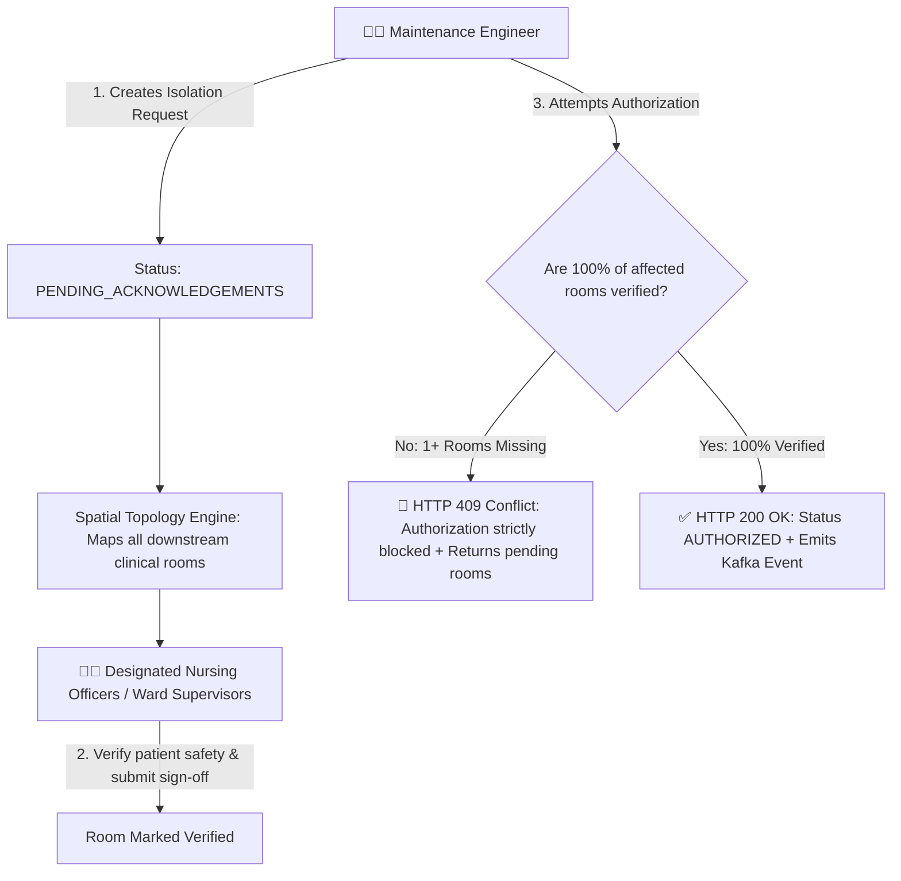
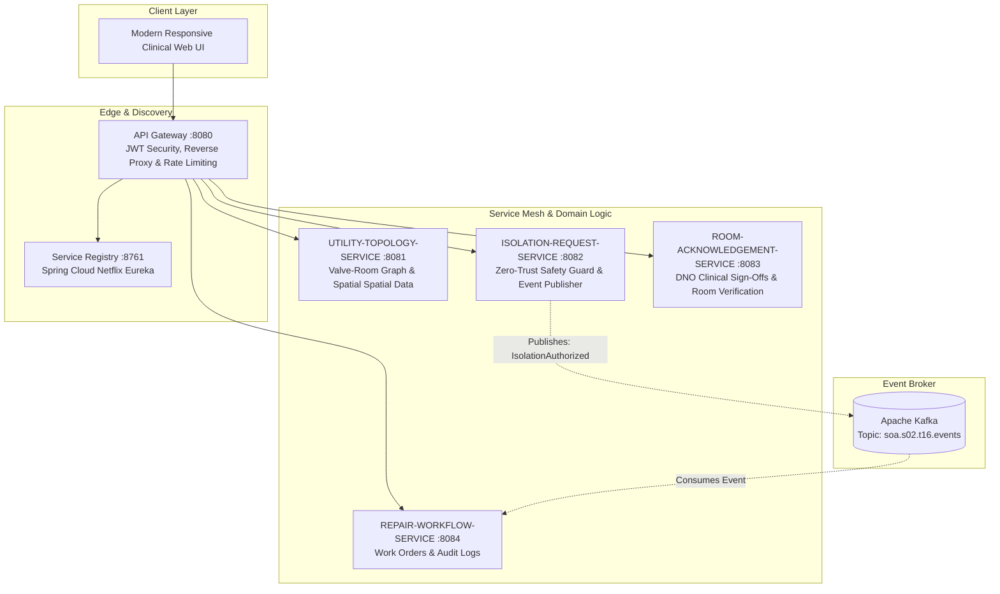

# 🏥 Hospital Maintenance Isolation System (HMIS)

[](https://adoptium.net/)
[](https://spring.io/projects/spring-boot)
[](https://spring.io/projects/spring-cloud)
[](https://kafka.apache.org/)
[](https://github.com/ASRIVATHSAVAREDDY5588/Hospital-Maintenance-Isolation-System/actions)
[](LICENSE)

An enterprise-grade, **Service-Oriented Architecture (SOA)** solution engineered to enforce safety-critical isolation workflows during hospital utility maintenance (Medical Oxygen, Vacuum, Compressed Medical Air, Potable Water, and Dialysis Loops).

---

## 📑 Table of Contents

- [Problem Statement & Healthcare Impact](#-problem-statement--healthcare-impact)
- [Zero-Trust Safety Guard](#-zero-trust-safety-guard)
- [SOA Architecture & Service Topology](#-soa-architecture--service-topology)
- [Key Features](#-key-features)
- [Pre-Seeded Hospital Clinical Wards](#-pre-seeded-hospital-clinical-wards)
- [Pre-Configured Security Roles & Accounts](#-pre-configured-security-roles--accounts)
- [Quick Start Guide](#-quick-start-guide)
- [REST API Reference Summary](#-rest-api-reference-summary)
- [Automated Testing & Verification](#-automated-testing--verification)
- [Repository Structure](#-repository-structure)
- [Documentation Index](#-documentation-index)

---

## 🚨 Problem Statement & Healthcare Impact

In a modern medical facility, central utility infrastructure supplies life-support gases and fluids across surgical, intensive care, and neonatal units:
- **Medical Oxygen ($O_2$):** Direct ventilator feeds in ICUs and Operating Theatres.
- **Medical Vacuum (Suction):** Continuous surgical cavity aspiration and anesthesia clearance.
- **Medical Compressed Air:** Neonatal and pediatric pulmonary respirators.
- **Specialized Water Loops:** Dialysis machines in Nephrology.

When a section of piping or a pressure regulator requires maintenance, engineers must close specific isolation valves. **Physically closing a valve isolates multiple rooms across multiple clinical wards simultaneously.**

> [!CAUTION]
> If maintenance begins before all affected rooms have verified patient relocations or portable backup switchovers, patients on life support will experience catastrophic supply failure.

The **Hospital Maintenance Isolation System** eliminates human error by enforcing an automated **Zero-Trust Safety Guard**.

---

## 🛡️ Zero-Trust Safety Guard



### Safety Principles:
1. **Automated Topology Mapping:** The engineer never has to guess which rooms are connected to which valve. The system automatically identifies all dependencies.
2. **Strict Cryptographic Sign-Off:** Only users with `ROLE_WARD_SUPERVISOR` can submit clinical sign-offs.
3. **Hard Conflict Enforcement:** If an engineer attempts authorization while even 1 room is unverified, the system returns `HTTP 409 Conflict` with the precise room numbers still pending.
4. **Asynchronous Event Choreography:** Once authorized, an `IsolationAuthorized` event is published to **Apache Kafka** (`soa.s02.t16.events`) to coordinate maintenance execution without blocking.

---

## 🏗️ SOA Architecture & Service Topology

The system is decomposed into 5 autonomous service domains conforming to enterprise SOA design principles:



### Core SOA Principles Demonstrated:
- **Service Autonomy:** Each service encapsulates its own bounded domain context and relational storage.
- **Loose Coupling:** The isolation service does not depend on downstream workflow completion; it communicates asynchronously via Kafka.
- **Service Discoverability:** Dynamic registration, instance health tracking, and heartbeats via **Spring Cloud Netflix Eureka**.
- **Stateless Authentication:** Stateless JWT bearer tokens verified on every request without session affinity.
- **Standardized Service Contracts:** Explicit REST contracts with structured JSON error responses.

---

## ✨ Key Features

- **Multi-Ward Utility Line Selector:** Switch between Medical Oxygen, Surgical Suction, Medical Air, Dialysis Water, and Emergency Sprinkler loops.
- **One-Tap Clinical Verification:** Dead-simple, human-friendly UI enabling nurses to verify room status in one tap.
- **Visual Safety Status Indicators:** Real-time badge indicators (amber for pending, emerald for verified).
- **Interactive Eureka Dashboard Modal:** Dedicated modal in the UI displaying all registered microservices, port allocations, live server uptime, JVM memory stats, and Kafka topic subscriptions.
- **Direct Database Explorer:** Embedded H2 console link in the UI header for direct database audits.
- **Comprehensive Automated Test Suite:** Unit and integration tests covering the complete authorization lifecycle, safety lockouts, and security boundaries.

---

## 🏥 Pre-Seeded Hospital Clinical Wards

| Valve Code | Utility Type | Clinical Departments Covered | Rooms Affected |
| :--- | :--- | :--- | :--- |
| **`VALVE-O2-MAIN`** | Medical Oxygen | ICU, CCU & Neonatal ICU (NICU) | 4 Rooms |
| **`VALVE-VAC-CRIT`** | Medical Vacuum | Operating Theatres (OT-1, OT-2) & PACU | 4 Rooms |
| **`VALVE-MEDAIR-SURG`** | Medical Air | Surgical Suites & Trauma Resuscitation | 3 Rooms |
| **`VALVE-DIALYSIS-LOOP`**| Purified Water | Nephrology & Acute Renal Dialysis | 3 Rooms |
| **`VALVE-FIRE-SPRINKLER`**| Fire Suppression | Maternity, Labor & Delivery, Emergency ER | 4 Rooms |
| **`VALVE-O2-EAST`** | Medical Oxygen | East Wing ICU & Post-Op Recovery | 3 Rooms |

---

## 👥 Pre-Configured Security Roles & Accounts

The application initializes with demo accounts configured in `DataInitializer`:

| Username | Password | Role | Clinical Designation |
| :--- | :--- | :--- | :--- |
| `engineer` | `password123` | `ROLE_ENGINEER` | Chief Maintenance Engineer (Can request isolation & authorize repair) |
| `supervisor1` | `password123` | `ROLE_WARD_SUPERVISOR` | DNO: Intensive Care Unit & Post-Anesthesia Recovery |
| `supervisor2` | `password123` | `ROLE_WARD_SUPERVISOR` | DNO: Surgical Suites, Operating Theatres & Trauma |
| `supervisor3` | `password123` | `ROLE_WARD_SUPERVISOR` | DNO: Pediatric Inpatient & Neonatal Care |

---

## 🚀 Quick Start Guide

### Prerequisites
- **JDK:** Java 21 or Java 25 installed
- **Build Tool:** Apache Maven 3.8+ (or use pre-packaged JAR)

### 1. Clone the Repository
```bash
git clone https://github.com/ASRIVATHSAVAREDDY5588/Hospital-Maintenance-Isolation-System.git
cd Hospital-Maintenance-Isolation-System
```

### 2. Run the Application

#### Option A: Using Windows Batch Scripts (Recommended)
```cmd
run-app.cmd
```
*Or run the pre-built jar directly:*
```cmd
run-jar.cmd
```

#### Option B: Using Maven
```bash
mvn clean spring-boot:run
```

### 3. Open in Browser
- **Web Application:** **[http://localhost:8080/](http://localhost:8080/)**
- **Eureka Service Registry Status:** **[http://localhost:8080/api/eureka/status](http://localhost:8080/api/eureka/status)**
- **H2 Database Console:** **[http://localhost:8080/h2-console](http://localhost:8080/h2-console)**
  - *JDBC URL:* `jdbc:h2:mem:hospitaldb`
  - *User:* `sa`
  - *Password:* *(leave blank)*

---

## 📡 REST API Reference Summary

| Method | Endpoint | Allowed Roles | Description |
| :--- | :--- | :--- | :--- |
| `POST` | `/api/auth/login` | Public | Authenticate user & retrieve JWT token |
| `GET` | `/api/auth/sample-users` | Public | View pre-seeded demo accounts |
| `GET` | `/api/eureka/status` | Public | View Eureka registered services & Kafka bus |
| `GET` | `/api/valves` | Authenticated | List all valves with connected rooms |
| `GET` | `/api/valves/{id}/rooms` | Authenticated | List affected rooms for a specific valve |
| `POST` | `/api/isolation-requests` | `ROLE_ENGINEER` | Create new valve isolation request |
| `GET` | `/api/isolation-requests/{id}` | Authenticated | Get isolation request details and room status |
| `POST` | `/api/isolation-requests/{id}/acknowledgements` | `ROLE_WARD_SUPERVISOR` | Sign off room safety |
| `POST` | `/api/isolation-requests/{id}/authorize` | `ROLE_ENGINEER` | Authorize repair start (strict zero-trust check) |

*For complete request/response schemas, JSON payloads, and error codes, refer to [docs/API_DOCUMENTATION.md](docs/API_DOCUMENTATION.md).*

---

## 🧪 Automated Testing & Verification

The project includes unit tests for core service isolation logic and end-to-end MockMvc integration tests for HTTP security and controller validations:

```bash
# Run unit and integration tests
mvn test
```
*Or on Windows:*
```cmd
run-tests.cmd
```

### Automated Live API Verification Script:
With the app running, execute the end-to-end PowerShell automated test script:
```powershell
.\test-api.ps1
```
*This script tests:*
1. Engineer and Supervisor JWT authentication
2. Spatial valve topology query
3. Creating a new isolation request
4. Attempting premature authorization & asserting `HTTP 409 Conflict`
5. Submitting room clinical sign-offs
6. Finalizing authorization & asserting `HTTP 200 OK`

---

## 📂 Repository Structure

```
Hospital-Maintenance-Isolation-System/
├── .github/
│   └── workflows/
│       └── ci.yml                     # GitHub Actions CI workflow
├── docs/
│   ├── ARCHITECTURE.md                # SOA microservice design, Kafka & Eureka specs
│   ├── API_DOCUMENTATION.md           # Full REST API payload & status code guide
│   └── SOA_VIVA_GUIDE.md              # 1-minute pitch script & viva Q&A
├── src/
│   ├── main/
│   │   ├── java/com/hospital/isolation/
│   │   │   ├── config/                # DataInitializer, SecurityConfig
│   │   │   ├── controller/            # REST Controllers (Auth, Valve, Isolation, Eureka)
│   │   │   ├── dto/                   # Request & Response Data Transfer Objects
│   │   │   ├── exception/             # Custom Exceptions & GlobalExceptionHandler
│   │   │   ├── model/                 # JPA Entities (Valve, Room, IsolationRequest, User)
│   │   │   ├── repository/            # Spring Data JPA Repositories
│   │   │   ├── security/              # JWT Token Provider & Filter
│   │   │   └── service/               # Domain Business Logic & Safety Guard
│   │   └── resources/
│   │       ├── application.yml        # Application configuration & H2 settings
│   │       └── static/
│   │           └── index.html         # Responsive Clinical Web UI with Eureka Modal
│   └── test/
│       └── java/com/hospital/isolation/
│           ├── IsolationIntegrationTest.java  # MockMvc integration tests
│           └── service/
│               └── IsolationServiceTest.java  # Core business logic unit tests
├── .gitignore                         # Build artifact ignore rules
├── pom.xml                            # Maven project object model
├── README.md                          # Repository overview & setup guide
├── run-app.cmd                        # Windows quick-launch batch script
├── run-jar.cmd                        # Windows pre-packaged jar runner
├── run-tests.cmd                      # Windows test suite runner
└── test-api.ps1                       # Automated end-to-end API verification script
```

---

## 📖 Documentation Index

- 📐 **[docs/ARCHITECTURE.md](docs/ARCHITECTURE.md)** — Architectural design, Eureka registry details, Kafka event schema, and ER diagrams.
- 📡 **[docs/API_DOCUMENTATION.md](docs/API_DOCUMENTATION.md)** — Detailed REST endpoint documentation with request/response examples.
- 🎓 **[docs/SOA_VIVA_GUIDE.md](docs/SOA_VIVA_GUIDE.md)** — 1-minute elevator pitch script and professor viva evaluation questions with ready-to-deliver answers.

---

## 📄 License

This project is licensed under the MIT License - see the [LICENSE](LICENSE) file for details.
