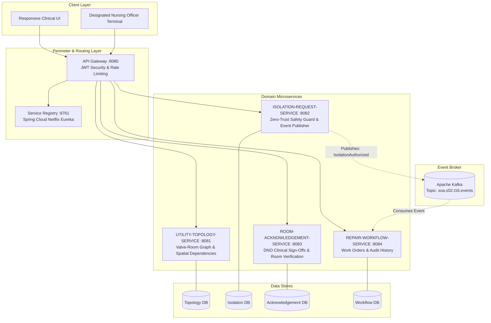
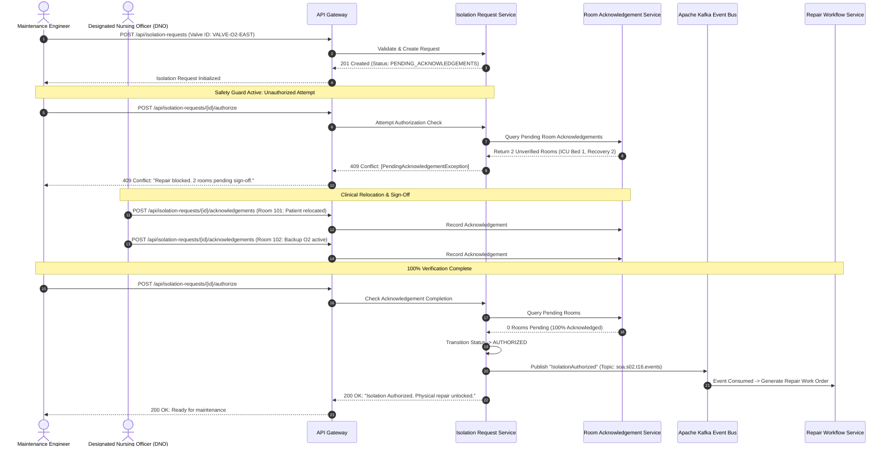
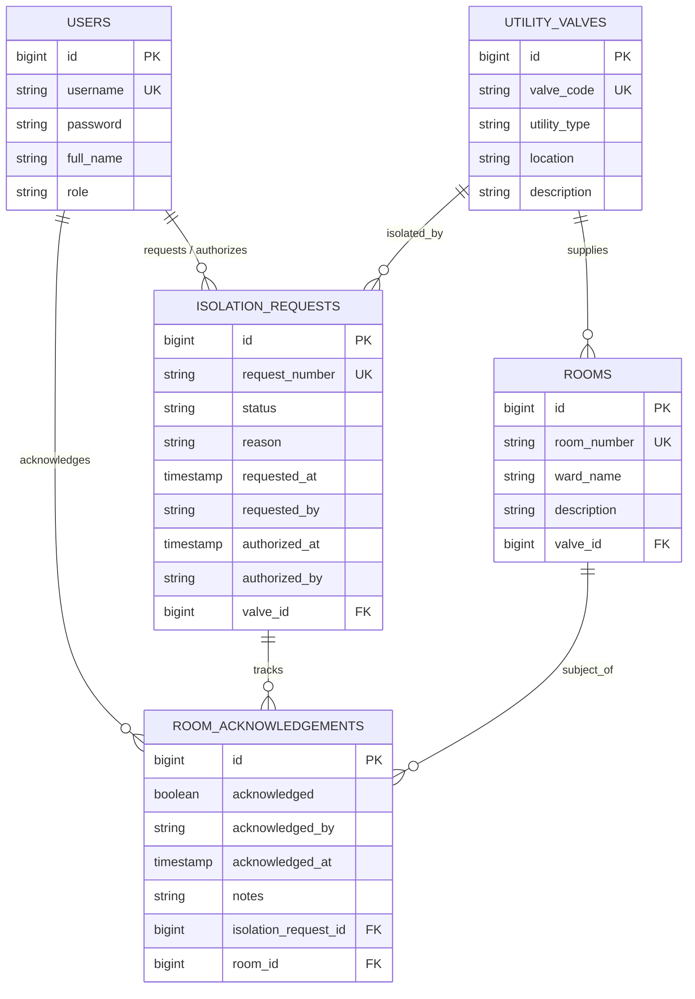

# 🏥 System Architecture & SOA Design Document

## 1. Executive Architectural Overview

The **Hospital Maintenance Isolation System** is engineered based on **Service-Oriented Architecture (SOA)** and **Microservice Architecture** patterns. In a healthcare facility, medical utility distribution (such as Medical Oxygen, Vacuum, Compressed Medical Air, and Dialysis Water) directly impacts patient safety in life-critical clinical environments (ICU, NICU, Operating Theatres, and PACU).

The system enforces a **Zero-Trust Safety Guard**: physically isolating a utility line for maintenance is **strictly prevented** (`HTTP 409 Conflict`) unless **100% of affected clinical rooms** have verified and acknowledged patient safety relocations or localized backup deployment.

---

## 2. Service-Oriented Decomposition



---

## 3. Microservice Specifications

| Microservice | Default Port | Primary Responsibility | Data Store |
| :--- | :--- | :--- | :--- |
| **API Gateway** | `8080` | Reverse proxy routing, stateless JWT validation, CORS, and centralized security. | Gateway Cache |
| **Service Discovery (Eureka)** | `8761 / embedded` | Dynamic service registration, heartbeat monitoring, and health checking. | In-Memory Registry |
| **Utility Topology Service** | `8081` | Graph dependencies between utility isolation valves and connected clinical rooms. | `TOPOLOGY_DB` |
| **Isolation Request Service** | `8082` | Manages maintenance requests, enforces the Zero-Trust Safety Guard (`409 Conflict`), and publishes authorized events. | `ISOLATION_DB` |
| **Room Acknowledgement Service** | `8083` | Collects clinical sign-offs and patient relocation confirmations from Designated Nursing Officers (DNOs). | `ACKNOWLEDGEMENT_DB` |
| **Repair Workflow Service** | `8084` | Consumes `IsolationAuthorized` events via Apache Kafka to generate repair work orders and track audit history. | `WORKFLOW_DB` |

---

## 4. Zero-Trust Safety Guard Workflow



---

## 5. Event Contract Specification

When a maintenance isolation achieves 100% room acknowledgement, an asynchronous event is emitted to Apache Kafka:

**Kafka Topic:** `soa.s02.t16.events`  
**Event Key:** `requestNumber` (e.g., `ISO-0002`)

```json
{
  "eventId": "evt_98741352-a3b1",
  "eventType": "IsolationAuthorized",
  "timestamp": "2026-10-27T11:01:40.672Z",
  "payload": {
    "requestId": 2,
    "requestNumber": "ISO-0002",
    "valveCode": "VALVE-O2-EAST",
    "utilityType": "MEDICAL_OXYGEN",
    "authorizedBy": "engineer",
    "totalRoomsAffected": 3,
    "affectedRooms": ["Room 101", "Room 102", "Room 103"],
    "authorizationStatus": "AUTHORIZED"
  }
}
```

---

## 6. Database Entity-Relationship Model


